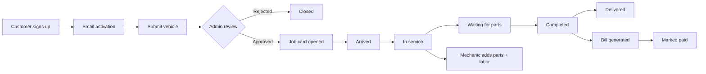

<div align="center">

# 🔧 Garage Management Application

**A full-stack system to run a vehicle service garage: intake, job cards, spare parts inventory and billing, all in one place.**

[](https://garage-management-application.vercel.app)


[**Live Demo**](https://garage-management-application.vercel.app) · [Features](#-features) · [Getting Started](#-getting-started) · [API](#-api-overview)

</div>

---

## 📸 Screenshot

<p align="center">
  
</p>

> 🌐 Try it live: **https://garage-management-application.vercel.app**
> No backend needed, use the [demo accounts](#-demo-accounts) below.

---

## 📖 About

Garage owners usually juggle paper job sheets, WhatsApp messages and spreadsheets. This project brings the whole service lifecycle into one app:

1. A customer signs up, **verifies their email**, and submits a vehicle for service.
2. An **admin approves or rejects** the request.
3. Once approved, a **job card** is opened and moves through its stages.
4. **Mechanics** attach the spare parts used and their charges.
5. A **bill** is generated and can be marked as paid.



---

## ✨ Features

- 🔐 **JWT authentication** with email activation on signup
- 👥 **Role-based access**: User, Mechanic and Admin, each with different permissions
- 🚗 **Vehicle intake and approval workflow**
- 📋 **Job card tracking** with status updates (arrived → in service → waiting for parts → completed → delivered)
- 📦 **Spare parts inventory** with full CRUD
- 🧾 **Billing**: spare part cost + labor + tax = total, with paid/unpaid status
- 📊 **Admin dashboard** with live counts and charts (active job cards, registered users, and more)
- 🎭 **Demo mode**: the frontend ships with mock accounts so you can explore the UI without running the backend

### Roles at a glance

| Role | What they can do |
|------|------------------|
| **User** | Register, add vehicles, track their own job cards, view their bills |
| **Mechanic** | View assigned job cards, update status, attach parts and charges |
| **Admin** | Approve/reject vehicles, manage job cards, inventory, bills and users, view analytics |

---

## 🛠 Tech Stack

| Layer | Technologies |
|-------|--------------|
| **Backend** | Java 21, Spring Boot 4, Spring Security + JWT, Spring Data JPA, Lombok, Maven |
| **Database** | PostgreSQL (H2 for local runs) |
| **Frontend** | React 18, TypeScript, Vite, Tailwind CSS, React Query, React Hook Form, Recharts |
| **DevOps** | Docker, Docker Compose, Vercel (frontend deployment) |

---

## 🗂 Project Structure

```
Garage-Management-Application/
├── Garage-Management-Application/      # Spring Boot backend
│   └── src/main/java/.../
│       ├── controller/                 # Auth, Admin, User, Vehicle, JobCard, Bill, SparePart
│       ├── entity/                     # User, Vehicle, JobCard, Bill, SparePart
│       ├── service/                    # Business logic
│       └── configs/                    # SecurityConfig (JWT + CORS + roles)
│
├── Garage-Management-frontend/         # React + Vite + TypeScript app
│   └── src/pages/
│       ├── auth/  dashboard/  user/  vehicles/  jobcards/
│       └── inventory/  billing/  customers/  reports/  settings/
│
└── docker-compose.yml
```

---

## 🚀 Getting Started

### Prerequisites

- Java 21+
- Node.js 18+ and npm
- PostgreSQL (or use H2 for a quick local run)
- Docker (optional)

### 1. Clone the repo

```bash
git clone https://github.com/DayeshLate/Garage-Management-Application.git
cd Garage-Management-Application
```

### 2. Run the backend

```bash
cd Garage-Management-Application
cp example.env .env          # fill in your DB + email details
./mvnw spring-boot:run
```

Backend runs on **http://localhost:8080**

### 3. Run the frontend

```bash
cd Garage-Management-frontend
npm install
echo "VITE_API_URL=http://localhost:8080" > .env
npm run dev
```

Frontend runs on **http://localhost:5173** (Vite default)

### 🐳 Or run with Docker

```bash
docker compose up --build
```

Backend on `localhost:8080`, frontend on `localhost:3000`.

> ⚠️ **Heads up:** `docker-compose.yml` currently provisions MySQL with `DATABASE_URL`-style variables, while `application.properties` expects PostgreSQL via `PGHOST` / `PGUSER` / etc. Align the two before relying on Docker for anything beyond testing. Also change `JWT_SECRET` and the email credentials in `docker-compose.yml`.

---

## 🔑 Environment Variables

**Backend**

| Variable | Description |
|----------|-------------|
| `PGHOST`, `PGPORT`, `PGDATABASE`, `PGUSER`, `PGPASSWORD` | PostgreSQL connection |
| `JWT_SECRET` | Secret used to sign JWTs (use a long random string) |
| `FRONTEND_URL` | Frontend origin, used for CORS and email links |
| `BACKEND_URL` | Public backend URL |
| `EMAIL_USERNAME`, `EMAIL_PASSWORD` | SMTP credentials for activation emails |

**Frontend**

| Variable | Description |
|----------|-------------|
| `VITE_API_URL` | Backend base URL (when set to a real backend, demo mode switches to real login) |
| `VITE_DEFAULT_CURRENCY` | Currency used when displaying prices |

---

## 🎭 Demo Accounts

Hardcoded on the frontend so you can explore without a backend:

| Role | Email | Password |
|------|-------|----------|
| Admin | `admin@garage.com` | `admin123` |
| User | `user@garage.com` | `user123` |

---

## 📡 API Overview

| Area | Base path | Key endpoints |
|------|-----------|---------------|
| **Auth** | `/api/auth` | `register`, `activate`, `login` |
| **User** | `/user` | `current`, `update/{id}`, `getAllCustomer` |
| **Vehicles** | `/user/vehicle` | `create`, `allUservehicle`, `getByStatus` |
| **Job cards** | `/user/jobCard` | `Active_count`, `Active_Services` |
| **Bills** | `/user/bill` | `getAll`, `getBillCountForUser`, `getAllBillsOfVehicle/{id}` |
| **Admin** | `/admin` | Vehicle approval, job card management, bill status updates, spare parts CRUD, user/job card counts |

Admin routes are restricted to `ADMIN`, with a few shared with `MECHANIC`. All protected routes require an `Authorization: Bearer <token>` header.

---

## 🗺 Roadmap

- [ ] Align Docker setup with PostgreSQL
- [ ] Email/SMS notifications on job card status changes
- [ ] PDF invoice download
- [ ] Automated tests (unit + integration)
- [ ] Swagger / OpenAPI documentation

---

## 🤝 Contributing

Contributions, issues and feature requests are welcome. Fork the repo, create a branch, and open a pull request.

---

## 👨‍💻 Author

**Dayesh Late**

- GitHub: [@DayeshLate](https://github.com/DayeshLate)
- Portfolio: [dayeshlate-portfolio.vercel.app](https://dayeshlate-portfolio.vercel.app)

---

<div align="center">

⭐ If you found this project useful, consider giving it a star!

</div>
